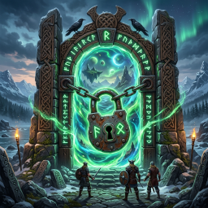

 # 🌀 TortalPortal

> *"The old way was to carve a name into the stone and hope another bore the same. A tally of runes, scratched and rescratched, and still you stepped through blind. Better to know the road before you walk it, Viking."*

**TortalPortal** is a complete overhaul of Valheim's portal network. Vanilla's tag-pairing is gone — walk up to any portal and a framed window opens listing every portal in the world, with the great map beside it marking your chosen destination. Each portal keeps a photograph of where it comes out — under that destination's own sky and weather, not yours — so you see the country you are stepping into before you commit to it. An experimental **live view** of the same place can be switched on if you want it moving.

📜 <b>Contents</b>

- [⚔️ Features](#features)
  - [🗺️ Every Portal in the Realm, Listed](#every-portal-in-the-realm-listed)
  - [📸 See Exactly Where You're Going](#see-exactly-where-youre-going)
  - [🔮 Watch Through the Gate](#watch-through-the-gate)
  - [🔱 Favorites](#favorites)
  - [🔒 Lock Your Gates](#lock-your-gates)
  - [🎯 Every Gate Its Own Mark](#every-gate-its-own-mark)
  - [🐺 Bring the Pack (and Ride It Through)](#bring-the-pack-and-ride-it-through)
  - [🚧 Decide What Travels](#decide-what-travels)
  - [🖼️ A Frame Worth Looking At](#a-frame-worth-looking-at)
  - [✨ The Runic Gateway](#the-runic-gateway)
  - [👑 Admin Supremacy](#admin-supremacy)
- [🍗 Instructions](#instructions)
- [🛠️ How-To](#how-to)
  - [🖼️ Give Your Portals Their Own Map Icons](#give-your-portals-their-own-map-icons)
  - [📡 Share Icons From Your Server](#share-icons-from-your-server)
  - [🌱 Seed a World with Portals](#seed-a-world-with-portals)
- [⚙️ Configuration](#configuration)
  - [Server-Synced (Admin Controlled)](#server-synced-admin-controlled)
  - [Local to Your Game](#local-to-your-game)
- [📦 Dependencies](#dependencies)

> 🔗 Check out my other mod **Mists of Avalor**? The open beta is live on [Hexium](https://valheim.hexium.gg/mods/Wubarrk/Mists_of_Avalor_BETA).

---

## ⚔️ Features

### 🗺️ Every Portal in the Realm, Listed
Step into range and the destination window opens: every portal in the world, sorted by name, each showing its lock state, its biome, how far it is from you, and who raised it. Search by name to cut a long list down. Selecting a destination pins it on the **Large Minimap**, which opens alongside the window, so you always see the route in context rather than guessing from a tag.

<!-- SCREENSHOT SLOT — save as shot-destinations.png beside this README, then delete these comment markers:

-->

The list is built by the **server**, which is the only machine that holds the whole world, and handed to each player as they log in — so it is complete from the first portal you touch. Install it on a world that has been running for months and the startup scan finds every gate already standing in it; you do not have to go and visit them first.

Every portal is **marked on the great map** while the window is open, labelled with its name — the map centres clear of the window rather than behind it, so you are looking at the country around your destination instead of the back of a frame. The marks are never saved and vanish when the window closes; your own pins are your own business.

The markers are **live**: click one to select that portal, click the chosen one again to travel — pick your destination off the country itself rather than out of a list. The one you've chosen is picked out from the rest — **30% larger and drawn in red** — so there is never any doubt which gate you are about to step through, while every other marker stays exactly the size and colour of a normal pin.

Walk away and the window closes itself. Arrive somewhere and it stays shut, so you are never greeted by a menu the instant you land — step off and walk back to bring it up again.

### 📸 See Exactly Where You're Going
Every portal quietly photographs its own destination when you raise it, on a wide-angle lens standing out in front of the gate, and stores the shot on the portal itself so **every player on the server sees it**. A background pass keeps the images current as the world changes around them, and portals that have never been photographed — every gate on a world that predates the mod — are shot first, so an established server fills its album in as people move about it.

The list shows each shot as a thumbnail — and **clicking it opens the photograph full screen** at your resolution, the portal's name across the top, captioned with the biome and coordinates. Arrows on either side (or the keyboard's arrow keys) **flip through every portal's picture like an album** without leaving the frame. Read the terrain, spot the tar pit, notice the Fuling camp, *then* decide.

<!-- SCREENSHOT SLOT — save as shot-album.png beside this README, then delete these comment markers:

-->

**No portal waits for a visitor.** Valheim only builds the world around players, so a gate nobody has stepped near could never be photographed — until now. The camera quietly *anchors* one unphotographed portal at a time, streams in a small patch of world around it out where nobody is, waits for the terrain to genuinely finish, takes the shot, and lets it all unload seconds later. Works on hosted worlds and dedicated servers alike; an established server fills its whole album on its own, horizon and all.

### 🔮 Watch Through the Gate — *experimental, off by default*
> ⚗️ **This one ships switched off.** Turn it on with `EnableLivePreviews`. It works, and it is the best way to see where a gate goes — the 1.3.1 fixes cleared its two real faults (a shimmer in the image, and feeds that refused to open after the first one), and what keeps it behind a switch now is honest cost: several seconds of warm-up on a large or distant destination, and it is the most expensive thing the mod does. **The stored photograph is the finished feature**, and everything below about photographs is fully supported.

Open a portal's picture full-size and the photograph gives way to a **live view of the destination** — real weather, real time of day, swaying trees, rendered by your own game through the same anchor the camera uses. **Right-drag looks around, the wheel zooms** (30°–100°). The still stands in while the far world streams in (a pulsing amber `GOING LIVE` badge on the frame, then a red `LIVE`), and closing the album unloads everything within seconds — the feed's lifecycle is a deadman switch, so there is no exit path that leaves a camera running.

Understand what it actually does before switching it on: this is not a video. Your game **builds** the destination and holds it standing while you watch — terrain, trees, buildings and creatures all genuinely there, sized by `AnchorZoneRing` — and on a dedicated server all of it crosses the wire to you first. It is by far the most expensive thing this mod does.

**And the destination gets its own sky.** Valheim keeps one sky, one sun, one set of weather and one field of grass, and welds the lot to wherever *you* are standing — so a camera in the Ashlands would otherwise show real Ashlands ground under your weather, with no ash falling and no ashen sky. Every anchored view now borrows the destination's own fog, sun, ambient light, weather and grass for the fraction of a second it is drawing, and hands your own view straight back. **Ash falls in the Ashlands. It rains in the swamp at night.** Turn it off with `AnchoredEnvironment` if you'd rather have the frames.

<!-- SCREENSHOT SLOT — save as shot-live.png beside this README, then delete these comment markers:

-->

### 🔱 Favorites
Click the small heart on any row - it turns gold: starred. Favorites sort to the top — and once you have some, the window opens as a **slender strip of just your favorites, one click to travel**, with an arrow that expands to the full list when you want the whole realm. The gates you use fifty times a day cost one click; everything else is one more. Favorites are stored on your own machine, per world, and renaming a portal keeps its star.

**And you can star the gate you're standing at.** The destination list leaves out your current portal — you can't travel to where you already are — which used to make your home base the one gate you couldn't favourite without walking to another portal first. The configuration window now carries its own **Favorite** toggle beside the PIN lock, so it's one click at the gate itself. It applies on **Save**, so Cancel discards it like everything else in that window.

<!-- SCREENSHOT SLOT — save as shot-favorites.png beside this README, then delete these comment markers:

-->

### 🔒 Lock Your Gates
Walk up to a portal you built and press `E` to open its configuration panel: set its name, choose its map icon, and toggle a PIN lock in one place. Anyone else selecting that destination must enter the PIN before the gate will take them.

Quick-launching a locked favorite (or clicking its map marker) gets the **quick PIN window**: the map closes, a small window opens with the keyboard already sitting in the field — type the PIN, hit `Enter`, and you are away. Wrong PIN says so on screen and clears the field for another try; `Esc` puts you back exactly where you were.

### 🎯 Every Gate Its Own Mark
Portal markers don't have to be vanilla's icons. By default every marker is TortalPortal's own **rune pin** — a glyph generated at runtime, sat on a dark disc inside a coloured ring so it reads as a deliberate mark rather than debris on a busy map — coloured by `PinColour`. `PortalPinIcon` swaps that for any of vanilla's five familiar icons, or for your own artwork.

**Eight hand-drawn icons ship in the box** — a boar with meat for eyes, a crowned neck, a party longship, a rainbow mead, a surprised greydwarf, a deathsquito on a sword, a troll sign and a wacky viking helmet — and **each portal picks its own** from a grid in the configuration window. Your mine wears a pickaxe, your swamp outpost a skull, your capital its own crest. A glance at the map tells you what each gate *is*, not merely that it exists.

<!-- SCREENSHOT SLOT — save as shot-iconpicker.png beside this README, then delete these comment markers:

-->

**And the artwork travels.** Drop your own PNGs into a folder on the server and every player downloads the ones they don't already have — once, cached by content — so a gate you mark with your own crest looks the same to everyone at the table with **nothing for them to install and no modpack to rebuild**. Add a file, run `tortal_pinreload`, and it is on everybody's map at their next login. The icons that ship with the mod are never sent, because everyone already has them.

The choice lives on the portal itself and travels in the destination index, so even portals nobody has ever visited are drawn with their proper marker. Full walkthrough: [🖼️ Give Your Portals Their Own Map Icons](#give-your-portals-their-own-map-icons).

<!-- SCREENSHOT SLOT — save as shot-mapmarks.png beside this README, then delete these comment markers:

-->

### 🐺 Bring the Pack (and Ride It Through)
Your loyal companions travel with you. Any tamed creature following you steps through at your side (`TameFollowRadius` sets how wide a circle is gathered).

**Riding? Stay in the saddle.** Teleport while mounted and the beast comes with you — you are lifted out of the saddle for the trip, it is sent through beside the exit, and you are seated again the moment you land. Built against the game's mount interface rather than any one saddle, so custom saddle items and modded mounts (OdinMounts and friends) ride through exactly like a Lox. Ships and carts stay where you left them; only a tamed creature qualifies.

### 🚧 Decide What Travels
Admins get a dual filtering system beyond vanilla's flat metal ban. Populate the **whitelist** to create an exclusive "these may pass" list, and use the **blacklist** to further restrict specific items — or switch the whole thing to `BypassAll` and let everything through. All of it is server-synced, so the rules are the server's, not each client's.

### 🖼️ A Frame Worth Looking At
Both portal windows are set in an ornate gilt frame: polished double rails, acanthus scrollwork mitring every corner, and a palmette crest struck into the top and bottom edges. It is drawn on a dark leather panel with gold-edged insets, and the destination list reads as a proper set of cards rather than a wall of text.

None of it is a shipped image. Every rail, flourish and crest is **generated in code at runtime**, lit by a single consistent light — the interface carries no textures, no shaders and no asset bundles, and cannot ever show you a missing-texture pink square. (The only files the mod installs are the eight map icons, and those are plain PNGs you can open, edit or delete.)

If the text is too small or too large for your display, `UITextScale` moves it between 0.6× and 3×, `UIFontSizeDelta` adds up to +24 flat points on top, and the rows, fields, buttons and windows all grow with it so nothing clips. Changes apply immediately. The metal itself is yours too: `UIGoldColour` re-skins the entire frame — silver, bronze, verdigris — from one dial, live.

### ✨ The Runic Gateway
Vanilla's portal effects are gone entirely — every last flare — and in their place stands a runic gateway: **small Elder Futhark glyphs drawn in off the edges of the opening**, swirling around the gate's own axis and spiralling slowly inward, each one taking its own shade from a band either side of your chosen colour so the gateway shimmers through a range rather than glowing one flat tone. Around them stand two counter-rotating rune circles, a magic circle scribed across the threshold, slow embers rising through the site, and a **swirling rune trail** — an unseen point orbiting the pillars, weaving up and down, drawing a continuous glowing ribbon strung with runes behind it.

<!-- SCREENSHOT SLOT — save as shot-gateway.png beside this README, then delete these comment markers:

-->

**And it breathes with your approach.** The gateway sits fully dormant — nothing drawn, nothing simulated — beyond `VFXWakeDistance`, and from there it does not switch on: it *builds*, strengthening the closer you come and bleeding gently away behind you as you leave. Walking off does not snap it shut; emission simply falls away and the runes already in the air drift out on their own, the way a flier's trail dissolves behind them. Any player drives it, so a friend walking up lights the gate for you too.

Two dials, and they move independently: `VFXIntensity` is **how much** gateway there is — density, rune spacing, ring thickness — while `VFXBrightness` is purely **how hard it burns**. Dim it to a smoulder without thinning it, or thicken it without the glare. `VFXColour` paints the lot, and every one of these applies live to portals already standing.

The gateway **measures each portal's own arch and centres itself in it**, so wood, stone and black marble portals all read correctly — and so will any portal a future update or another mod adds.

### 👑 Admin Supremacy
A built-in bypass lets admins ignore PIN locks, item filters and portal placement limits entirely.

---

## 🍗 Instructions

*A start-to-finish guide to actually using the thing:*

1. **Place a portal** — the game snaps a hidden high-resolution photo of its destination for the preview system.
2. **Configure it** — walk up and press `E`. Set its name, pick the icon it shows on the map, and toggle a PIN lock (see [Give Your Portals Their Own Map Icons](#give-your-portals-their-own-map-icons)).
3. **Travel** — walk into the portal's range. Pick a destination from the list — or click its marker on the map, and click it again to go.
4. **Look before you leap** — click a destination's thumbnail (or hit Teleport with the picture open) to see it full screen. Arrow keys or the on-screen arrows flip through every portal's picture like an album; give it a moment on a photo and it goes **`LIVE`** — a real-time window onto the destination you can look around with a right-drag and zoom with the wheel.
5. **Locked gates** — launching a PIN-locked portal from a favorite or a map marker opens the **quick PIN window** with the keyboard already in the field: type it, hit `Enter`, go. A wrong PIN clears itself for another try.
6. **Favorites** — the heart on a row stars it, gold means starred. With favorites set, the window opens as a one-click launcher strip; `»` expands to the full list.
7. **Riding** — stay in the saddle and hit Teleport; you and the mount arrive together and you are re-seated automatically.
8. **On arrival** — the menu stays shut so you can get on with it. Step away and walk back to bring it up again.
9. **Typing** — the destination window focuses its filter box as it opens, so you can just start typing a name. While any of the mod's fields has the keyboard your character stands still and hotkeys hold their peace. `Escape` hands it back without closing the window.

---

## 🛠️ How-To

### 🖼️ Give Your Portals Their Own Map Icons

Eight icons are installed already. You can add **any number** of your own and give **each portal its own**.

**1. Mark a portal**

1. Open its configuration window. Two ways in, and **the button is the reliable one**: with the destination window open, click **`Configure`** in the top row, just left of `Close`. (Pressing `E` at the gate does the same thing, but only when no text field has the keyboard — Valheim gates its Use key behind `Player.TakeInput()`, so a focused search box quietly swallows the keypress.)
2. Use the **Map icon** grid — `—` means *no icon of its own*, and the portal falls back to whatever your `PortalPinIcon` setting says. Click any other cell to choose it. If there are more icons than fit in the two rows, the last cell reads **`+N ▸`** and opens a scrolling panel with all of them.
3. Hit **Save**. The choice is stored on the portal, so every player sees that marker — including players who have never been anywhere near the gate.

**2. Add your own artwork**

1. Make or find your PNGs — transparency is respected, so a clean glyph or crest on a transparent background reads best.
2. Drop them into the **`TortalPortalPins`** folder beside `TortalPortal.dll`, alongside the eight that came with the mod.
3. **The filename is the icon's name**, so `Mine.png` shows up as `Mine`. Underscores read as spaces in the picker, so `deep_mine.png` shows as *deep mine* — but the filename is what is actually stored, so renaming a file later un-marks every portal using it. Name them once and leave them.
4. Restart the game — your own folder is read at startup. (Icons arriving **from a server** need no restart.)

> 💡 **Your portal's name and its icon are completely separate.** A gate called *Bonemass Camp* can wear `troll_sign`; two gates both called *Home* can wear different icons; a gate you happen to name *troll_sign* gets no icon from it. Rename a portal and it keeps its marker; change its marker and it keeps its name.

> 💡 **About image size.** Vanilla draws every map marker into a fixed square box — 48 px on the great map, 32 px on the minimap — so an image of *any* resolution is scaled into that box and can never spill across your map. Size doesn't hurt what you see; it hurts what you pay. A 4096×4096 PNG holds roughly **64 MB of video memory** to draw something 48 pixels across, and the mod will say so in the log. **The eight shipped icons are 48×48, which is exactly the box** — that is the sweet spot. Anything a server shares is capped at 256×256 and 96 KB. Non-square images are letterboxed to fit rather than stretched, but square fills the marker best.

> 💡 **Want one of these as your *own* default marker?** Set `PortalPinIcon = Custom` and put the icon's name in **`DefaultPinIcon`** — `troll_sign`, say. That is the marker every portal wears until it picks one of its own. It works for icons the server sent you as well as your own files, which is why it is a name rather than a filename: there is no file of yours to point at.

> 💡 **Upgrading from a single icon?** The old single-file `TortalPortalPin.png` beside the plugin still works exactly as it always has — leave `DefaultPinIcon` empty and `PortalPinIcon = Custom` keeps using it. Nothing needs moving.

> 💡 **The gate you're standing at is marked too**, labelled `(here)`. It isn't in the destination list — you can't travel to where you already are — but it is on the map, so an icon you just set on your home base shows up straight away.

### 📡 Share Icons From Your Server

Your players do not need your PNGs. **The server can hand them out.**

1. Drop your PNGs into the **`TortalPortalPins`** folder beside the **server's** `TortalPortal.dll` — the same folder name clients use, because a dedicated server installs the same package.
2. Run **`tortal_pinreload`** from any admin's console (or restart the server). It rescans the folder and tells every connected client what it now has.
3. That's it. Each client quietly downloads only the icons it is missing, one at a time, and caches them by content — so the download happens **once per machine, ever**, even across different servers and different worlds.

What that buys you: mark a gate with your guild's crest and everyone sees the crest, with nothing to install, no modpack rebuild and no version bump. A player who joins with a bare install still gets the full set.

- **Icons everyone already has are never sent.** The eight that ship with the mod, and anything a player already put in their own folder, are matched by content and skipped.
- **Same name, different picture?** The server's copy wins, so everyone at the table is looking at the same thing. Your own file is left untouched on disk and the log says once which one it used.
- **Limits.** 256×256, 96 KB and 64 icons per world. Oversized files are named in the server log and simply not offered.
- **Don't want any of it?** `ShareIconsFromServer = false` and every player sees only what is on their own disk.

### 🌱 Seed a World with Portals

Two console commands ship with the mod — the same ones every 1.2.0 feature was shaken down with. Both are cheat commands: enable `devcommands` in the console first, which on a server means being on its adminlist.

- **`tortal_scatter [count] [radius]`** — raises portals at random spots across the world. Default 25 within 2 000 m; up to 500 at a time, radius up to 10 000 m. Spots are spread evenly across the disc rather than crowding the middle, each gate is named for its biome and registered in the index like any hand-built portal, and every 5th one is PIN-locked with `1234` so locks have test subjects too.
- **`tortal_scatterclear`** — removes every portal `tortal_scatter` raised and *nothing else*: scattered gates carry a marker, hand-built portals are never touched. Run from a client it sweeps what is loaded around you **and** asks the server to sweep the whole world (admin-gated), reporting the total back to your console.

Together with remote snapshots this is a **world-seeding tool**: scatter a network across the map on day one — `tortal_scatter 100 10000` covers the whole world — and the camera walks it on its own, portal by portal, until the server opens with a fully photographed network no player has ever visited. Keep the gates, or `tortal_scatterclear` when you have placed your own.

---

## ⚙️ Configuration

Settings live in `wubarrk.TortalPortal.cfg`.

**Your settings survive updates.** The file carries a layout version, and when the mod changes shape it is backed up beside itself and every value is carried over — a whitelist you spent an evening on does not evaporate because a setting moved sections. If something genuinely no longer exists, it is named in the log with its value and the path of the backup rather than vanishing quietly.

### Server-Synced (Admin Controlled)
| Setting | What it does |
| :--- | :--- |
| `FilterMode` | `Vanilla` (default), `WhitelistBlacklist`, or `BypassAll`. |
| `WhitelistItems` | Comma-separated, empty by default. Any item here bypasses vanilla portal restrictions (e.g. adding `Bronze` lets you teleport with Bronze, but Iron remains blocked). |
| `BlacklistItems` | Comma-separated, empty by default. Any item here is explicitly blocked, even if it normally would be allowed. |
| `MaxPortalsPerPlayer` | Limit how many portals each player can construct. **Unlimited by default** — `0` or any negative number means no cap at all. Set a positive number to enforce one. |
| `AdminBypass` | Default on. Lets admins ignore portal limits, PIN locks and item filters. |
| `AllowTames` | Default on. Whether tamed creatures follow you through. |
| `TameFollowRadius` | `2`–`30` metres, default `10`. How far around you following tames are gathered when you travel. |
| `AllowMountedTeleport` | Default on. Teleporting while riding brings the mount and re-seats you on arrival — vanilla saddles, custom saddle items and modded mounts alike. Off means dismount and walk through. |
| `MenuOpenDistance` | `0.1`–`5` metres, default `1.25`. How close you must be before the destination window and map open by themselves. The window is something you go and get rather than something that meets you on the path — but 0.8 m meant standing practically inside the gate, which read as the mod being unresponsive. Measured horizontally, so a raised platform adds no phantom distance. The portal's visuals keep their own range regardless. |
| `EnableCustomVFX` | Default on. Replaces vanilla portal particles with the runic gateway. |
| `EnablePortalCameraShot` | Default on. Whether placing a portal captures a preview snapshot. |
| `SnapshotRefreshIntervalMinutes` | Default `5`. How often already-photographed portals are re-shot, so a rebuilt or burnt-out destination stops showing the old view. `0` disables refreshes; portals with no picture are still filled in regardless. |
| `EnableRemoteSnapshots` | Default on. The camera walks the world on its own: portals nobody is near are briefly anchored, photographed and unloaded again — including over a dedicated server. Off means only portals loaded around players are photographed, as before 1.2.0. |
| `EnableLivePreviews` | **EXPERIMENTAL — default OFF.** Opening a photograph full-size streams a live view of the destination. Known rough edge: several seconds of warm-up on a large or distant destination. Also the most expensive thing the mod does — it builds and holds the far world while you watch. Off means the album shows stills only. |
| `AnchoredSpawning` | **Default ON from 1.3.1 — and read this so you know what it does.** Lets wildlife appear at a destination while somebody is watching it live, promptly — no ten-second spawner warm-up. Valheim only makes creatures where a *player* stands, which is why a far gate can be fully loaded, correctly lit and still look like nowhere anybody lives. The creatures are **real** — written into the world, simulated by whoever is watching, and still there after the view closes — so browsing a lot of gates can seed a lot of neighbourhoods. This is the one setting here that changes the world rather than a picture of it. Never done by the unattended background photographer. Turn it off to make looking at a gate change nothing. |
| `AnchoredEnvironment` | **Default on.** Gives a far-off portal its own sky. Valheim keeps one sky, one sun, one set of weather and one field of grass, all welded to wherever you are standing — without this a camera in the Ashlands shows real Ashlands ground under *your* weather. On, the anchored camera borrows the destination's own fog, sun, ambient light, weather particles and grass for the fraction of a second it draws, and your own view is handed straight back. Off returns to photographs and feeds wearing your local weather. |
| `CameraResolution` | Dropdown: `Res480p` / `Res720p` / `Res900p` / `Res1080p` (default). What the portal camera renders at — stored snapshots and live feed both. Stored pictures travel to every player, so higher resolutions cost real bandwidth; existing photographs keep the size they were taken at. |
| `AnchorZoneRing` | `1`–`2`, default `2`. How much world a far shot loads: 1 = 3×3 zones (192 m), 2 = 5×5 (320 m). A 3×3 block puts the horizon barely past the gate, and a destination photograph exists to show you the country you are stepping into. Hard-capped at 2 — a wider ring is a guaranteed hitch on any hardware. |
| `AnchorSettleBudgetSeconds` | `10`–`120`, default `40`. How long a far shot may wait for the destination to settle before the attempt is skipped and retried a later lap. Also where the live preview stops waiting for perfection and goes live with what is standing. |
| `AnchorSettleRadius` | `30`–`300` m, default `100`. How far around the portal terrain must be finished rebuilding before a scene counts as settled. |
| `PortalIndexRefreshSeconds` | `5`–`300`, default `10`. How often the server rescans the world and republishes the destination list — how quickly a new portal, rename or demolition reaches everyone. Only sent when something actually changed. |
| `ShareIconsFromServer` | **Default on.** Offers the server's own map icons to every player, who each download only what they are missing and cache it by content. Icons a client already has — including the eight that ship with the mod — are never sent. Off means every player sees only the icons on their own disk. See [📡 Share Icons From Your Server](#share-icons-from-your-server). |

### Local to Your Game
*(Not synced — set these however you like.)*

| Setting | What it does |
| :--- | :--- |
| `UITextScale` | `0.6`–`3.0`, default `1.05`. Scales all portal UI text and the layout around it. Applies immediately, no restart. |
| `UIFontSizeDelta` | `-6`–`+24` points added flat to every text size, after the scale. Default `+6`. Fatty shares this theme and this setting — match the numbers and the two mods' windows read identically. |
| `MenuCloseMargin` | `0`–`5` metres, default `1`. How much further out than `MenuOpenDistance` you must retreat before an open window closes itself — the hysteresis that stops it strobing on the boundary. |
| `ShowDestinationPreviews` | Default on. Off drops the photograph panel and narrows the window. Snapshots are still captured and shared either way. |
| `OpenFavoritesView` | Default on. When you have favorites, the window opens as the slim favorites strip; the `»` arrow expands it regardless. |
| `FocusSearchOnOpen` | **Default off.** Puts the text cursor straight in the search box as the window opens. Off because the window opens while you are still walking, and a focused field swallows WASD as typing. |
| `VFXOrbHeightOffset` | Default `0`. Metres to nudge the rune orb up or down inside the gate. The orb auto-centres on each portal's arch, so this is only for fine-tuning. |
| `VFXWakeDistance` | `2`–`50` metres, default `25`. How close a player must be before the dormant gateway wakes — far enough that a gate is already alive as it comes into view and builds as you walk in. |
| `VFXIntensity` | `0.1`–`3`, default `0.64`. How **much** gateway there is: particle density, ring thickness, rune spacing in the swirl. |
| `VFXBrightness` | `0.1`–`3`, default `0.35`. How **brightly** it burns, with no effect on how much of it there is. The materials are additive, so this climbs fast. Applies live. |
| `VFXSwirlDensity` | `0.25`–`3`, default `3`. How thickly the runes trailing off the gateway are laid along their ribbon — higher packs them tighter along the same path. Independent of `VFXIntensity`. Applies live. |
| `VFXTintPortalFrame` | **Default off.** Tints the portal piece's own glowing panel and gate light to `VFXColour`, so the gate and the gateway read as one object instead of an orange portal wearing a coloured light show. Only emissive surfaces are touched; timber, stone and metal keep their own materials. Off because vanilla's warm light against cool runes is a look in its own right. Applies live. |
| `VFXColour` | The gateway's colour — veil, rings, sigil, motes and swirl all draw from it. Colour picker in ConfigurationManager. Default warm gold `#FFD24C`. |
| `PinColour` | The Rune map pin's colour. Vanilla icons and custom PNGs bring their own. Default hard green `#12FF21`. |
| `UIGoldColour` | The window frames' metal. Shadow and highlight derive from it — silver, bronze or verdigris is one change, applied live. Default antique gold `#CC9E42`. |
| `ShowPortalPinsOnMap` | Default on. Marks every listed portal on the large map while the destination window is open. Never saved, removed when the window closes. |
| `PortalPinIcon` | Default `Rune` — TortalPortal's own glyph-in-a-ring. Also vanilla's five icons, or `Custom` to use whichever icon `DefaultPinIcon` names. This is the **fallback** for portals that haven't picked an icon of their own, and for icons you can't draw yet. See [🖼️ Give Your Portals Their Own Map Icons](#give-your-portals-their-own-map-icons). |
| `DefaultPinIcon` | Empty by default. Which icon `PortalPinIcon = Custom` should draw. **In ConfigurationManager this is a dropdown of every PNG in your `TortalPortalPins` folder** — pick one, no typing. You can also type the name of an icon the *server* sent you, since those have no file here for the list to find. Empty falls back to a `TortalPortalPin.png` beside the plugin if you have one, then to the Rune pin. Anything unresolvable is named in the log along with every icon you *do* have. |
| `EnableDebugLogging` | **Default off.** Verbose logging for UI, icon and teleport events. |

---

## 📦 Dependencies

> ⚠️ **Requires:** BepInEx

---

 
<small>

**License to Modify:**
User may alter, translate, or create derivative works based on the original material, provided two conditions are met: 1) A request to alter the work is made and approved by the original author (waived in the case of simple translations), and 2) Full attribution is given to the original author along with a link to the original work (if still available).  All changes should be clearly marked or noted as modified from the original source.

Modification or reuse of the work does not grant the user any right to imply official endorsement or sponsorship by the original creator.

The permission granted herein is non-exclusive, and the original creator retains all rights, title, and interest in the original work.

</small>
